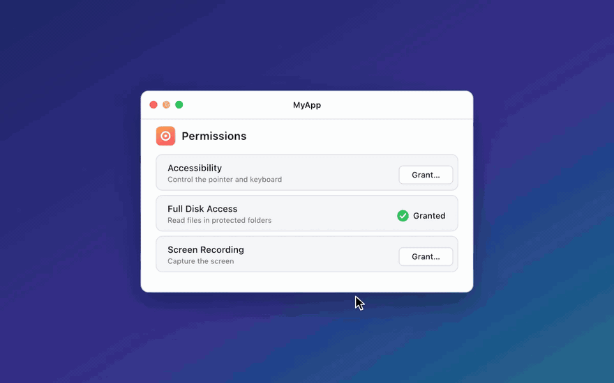

# PermissionGuide

Guided permission setup for macOS apps. PermissionGuide opens the right System Settings
pane, dims everything but the list, and docks a panel beside it with your app's icon to
drag in. When macOS reports the grant, your app comes back to the front.



```swift
import PermissionGuide

let permissions = PermissionManager()

if await permissions.request(.fullDiskAccess).isGranted {
    // granted
}
```

It covers Full Disk Access, Accessibility, Screen Recording, Input Monitoring, Bluetooth,
Developer Tools, App Management, system extensions and `SMAppService` background items.
It can also add a Set Up section to your `.pkg` installer.

## Use it with your agent

Paste this into your coding agent, with the permissions you need:

```text
Add PermissionGuide (https://github.com/fcjr/PermissionGuide) to this app. Read https://raw.githubusercontent.com/fcjr/PermissionGuide/main/llms.txt first, then build a permissions screen for <Accessibility, Full Disk Access, ...> that shows each one's status and has a Grant button.
```

## Add it

```swift
.package(url: "https://github.com/fcjr/PermissionGuide.git", from: "0.1.0"),
```

Requires macOS 14 and a signed `.app` without the App Sandbox.

[Guide](docs/guide.md) · [Installer panes](docs/installer.md) · [How it works](docs/how-it-works.md) · [Examples](Examples)

## Try it

```sh
just demo       # build and open PermissionGuideDemo.app
just demo-pkg   # build and open InstallerDemo.pkg
```

The demos need [just](https://github.com/casey/just). They are ad-hoc signed, so macOS
treats each rebuild as a new app; `just reset` clears the old grants.

MIT. The GIFs are drawn in code, from [`Media/`](Media).
