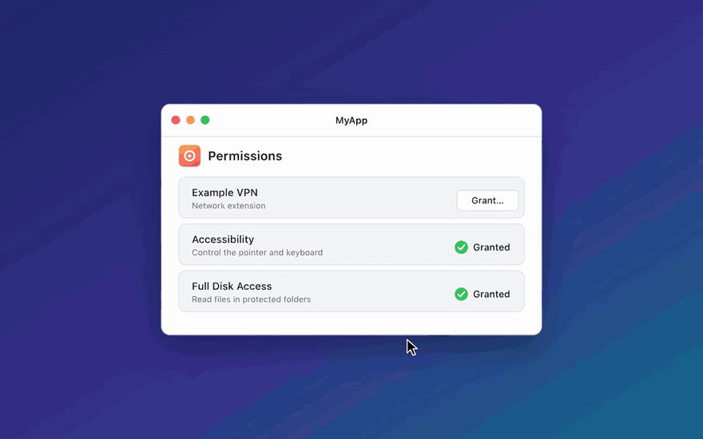

# Using PermissionGuide

Everything `PermissionManager` does. For installer panes see [installer.md](installer.md), and for
how the guide finds windows and prompts see [how-it-works.md](how-it-works.md).

## Supported permissions

| Permission | Pane | Status check |
| --- | --- | --- |
| `.fullDiskAccess` | Full Disk Access | ✓ (may need a relaunch) |
| `.screenRecording` | Screen & System Audio Recording | ✓ (may need a relaunch) |
| `.accessibility` | Accessibility | ✓ |
| `.inputMonitoring` | Input Monitoring | ✓ (may need a relaunch) |
| `.bluetooth` | Bluetooth | ✓ |
| `.developerTools` | Developer Tools | No API; user clicks Done |
| `.appManagement` | App Management | No API; user clicks Done |
| `.systemExtension(...)` | Login Items & Extensions | ✓ via `OSSystemExtensionRequest` |
| `.backgroundItem(daemonPlist:)` | Login Items & Extensions → Allow in the Background | ✓ via `SMAppService` |

System extensions cover VPN providers, content filters and DNS proxies
(`.networkExtension`), Endpoint Security clients (`.endpointSecurity`), DriverKit
drivers and camera extensions.

Prompt-only permissions (Camera, Microphone, Automation, Files & Folders, …) aren't
included. An app shows up in those lists only after it asks through the framework's
own API.

## App requirements

- **A real, signed `.app` bundle.** macOS tracks permissions per signed app, and the
  user drags the bundle itself. A bare `swift run` executable won't work.
- **No App Sandbox.** PermissionGuide is built for Developer ID apps. In a sandbox the Full
  Disk Access check looks inside the app's container and always fails, and system
  extensions can't be installed.
- **`NSBluetoothAlwaysUsageDescription`** in Info.plist if you use `.bluetooth`.
- **Your executable can be launched as a probe.** To see grants that only apply after a
  relaunch, PermissionGuide runs `Bundle.main.executableURL` with `PERMISSIONGUIDE_PROBE`
  set. A C constructor in `PermissionGuideProbe` answers through the exit status and exits
  before `main`, so none of your startup code runs. This works on its own when the app
  links PermissionGuide, statically or not. Your own `__attribute__((constructor))` or
  `+load` code can still run first, so keep it free of side effects. If the probe's
  constructor didn't run in your process (it wasn't linked in), PermissionGuide doesn't
  probe, so it never launches a second copy of your app.

## Create a manager

`PermissionManager` is `@Observable` and runs on the main actor. Create one, keep it
alive for as long as you need it, and list the permissions it should track:

```swift
import PermissionGuide

@State private var permissions = PermissionManager(
    permissions: [.accessibility, .fullDiskAccess, .screenRecording]
)
```

With no arguments it tracks every privacy permission (`Permission.privacyPermissions`).
It re-checks status every 0.75 seconds (`pollInterval:`), so views that read it update
by themselves.

## Check status

```swift
switch permissions.status(of: .fullDiskAccess) {
case .granted: …
case .notGranted: …
case .unknown: …   // macOS can't report it (Developer Tools, App Management)
}

permissions.statuses   // [Permission: PermissionStatus] for every tracked permission
permissions.pending    // the permission whose guide is showing, if any
```

Checking never shows a system prompt.

## Request a permission

```swift
switch await permissions.request(.fullDiskAccess) {
case .granted: …
case .confirmed: …
case .cancelled: …
case .failed(let error): …
}
```

This opens the pane in System Settings, highlights the list, and shows a panel with your
app's icon for the user to drag in. It returns a `PermissionResult`:

- `.granted` once macOS reports the permission granted.
- `.confirmed` if the user clicks **Done** for a permission macOS can't check.
- `.cancelled` if the user clicks **Cancel**, you call `permissions.cancel()`, the calling
  `Task` is cancelled, or another `request` starts before this one finishes.
- `.failed(error)` if a system extension fails to activate.

`result.isGranted` is `true` for `.granted` and `.confirmed`. In every case the guide
closes and your app comes back to the front. If the permission is already granted,
`request` returns `.granted` right away without opening anything.

Options:

```swift
await permissions.request(
    .screenRecording,
    dragging: helperURL,                 // bundle to drag in; defaults to your app
    tint: .systemPurple,                 // highlight and panel color
    isGranted: { helper.canRecord }      // custom check, for when the default can't see it
)
```

When macOS asks for Touch ID or a password, or System Settings offers to quit and reopen
your app, the guide highlights that prompt and tells the user what to do. Set
`permissions.relaunchChoice = .later` if relaunching would interrupt something; the
default, `.quitAndReopen`, suggests restarting.

## Permissions that need a relaunch

Full Disk Access, Screen Recording and Input Monitoring
(`permission.mayNeedRelaunch`) can keep reading as `.notGranted` in the running app
after the user grants them. System Settings then offers **Quit & Reopen** or **Later**.
PermissionGuide checks these from a fresh copy of your app (see
[App requirements](#app-requirements)), so:

- **Quit & Reopen.** macOS quits your app. The guide closes on the way out, and code
  after the pending `request` may not get to run before the process ends, so save any
  progress before you call it. After the relaunch the permission is `.granted`.
- **Later.** The guide finishes and `request` returns `.granted`. `status(of:)` reads
  `.granted` too, but your process can't use the permission yet, so
  `needsRelaunch(_:)` is `true` until the app restarts. Offer a restart:

```swift
if case .granted = await permissions.request(.fullDiskAccess),
   permissions.needsRelaunch(.fullDiskAccess) {
    showRestartButton()   // relaunch however your app does it
}
```

`needsRelaunch(_:)` is observable, so a view that reads it updates when the answer changes.
The same check also catches grants made in System Settings outside the guide. Tracked permissions
are probed every 5 seconds, and `request` probes before it opens anything, so it returns
`.granted` right away for a grant the app can't see yet.

## A SwiftUI permission screen

```swift
struct PermissionsView: View {
    let permissions: PermissionManager

    var body: some View {
        List(permissions.permissions) { permission in
            HStack {
                Text(permission.displayName)
                Spacer()
                if permissions.status(of: permission) == .granted {
                    Label("Granted", systemImage: "checkmark.circle.fill")
                } else if permissions.pending == permission {
                    ProgressView().controlSize(.small)
                    Button("Cancel", action: permissions.cancel)
                } else {
                    Button("Grant…") {
                        Task { await permissions.request(permission) }
                    }
                }
            }
        }
    }
}
```

`Examples/PermissionGuideDemo` is a fuller version of this screen.

## Helpers

When a helper process, not your app, needs the permission (for example, a server that
spawns shells), have the user drag the helper. Your app can't read another process's
permissions, so pass a check that can, such as asking the helper over IPC:

```swift
await permissions.request(
    .fullDiskAccess,
    dragging: Bundle.main.bundleURL.appending(path: "Contents/Helpers/MyHelper.app"),
    isGranted: { helper.reportsFullDiskAccess }
)
```

Without `isGranted`, the panel shows a Done button, because PermissionGuide can't tell when
the helper has been granted.

## System extensions

Describe each extension your app embeds, and track it like any other permission:

```swift
let vpn = SystemExtension(
    identifier: "com.example.app.tunnel",   // the extension's bundle identifier
    category: .networkExtension,
    displayName: "Example VPN"              // the name next to its switch in System Settings
)
let permissions = PermissionManager(permissions: [.fullDiskAccess, .systemExtension(vpn)])
```

Categories: `.networkExtension` (VPN providers, content filters, DNS proxies),
`.endpointSecurity`, `.driverExtension` and `.cameraExtension`.



### Before you request

macOS refuses to activate an extension unless the app is set up for it. Check with
`setupIssues()` first, and show or log what's wrong:

```swift
let issues = vpn.setupIssues()   // [] when ready
for issue in issues { print(issue) }
```

It catches the common mistakes:

- The app isn't in `/Applications`.
- The app lacks `com.apple.developer.system-extension.install`.
- No `.systemextension` with the identifier in `Contents/Library/SystemExtensions`.
- The extension lacks its category's entitlement
  (`com.apple.developer.networking.networkextension`,
  `com.apple.developer.endpoint-security.client` or `com.apple.developer.driverkit`).

An empty list doesn't guarantee activation. macOS also requires a Developer ID
signature, notarization and a provisioning profile that grants those entitlements.
Endpoint Security entitlements need Apple's approval. During development,
`systemextensionsctl developer on` (with SIP disabled) relaxes the location and
notarization checks.

### Installing and approving

```swift
if vpn.setupIssues().isEmpty {
    let result = await permissions.request(.systemExtension(vpn))
}
```

`request` submits `OSSystemExtensionRequest.activationRequest`, which installs the
extension: macOS copies it out of your app bundle and asks the user to approve it.
PermissionGuide then opens the extension pane and guides the user to the switch. It
returns `.granted` once the extension is active, `.failed(error)` if activation fails, and
`.cancelled` if the user cancels.

If your app already submits its own `OSSystemExtensionRequest`, call `guide(to:)` from
`requestNeedsUserApproval` instead. It shows the walkthrough without installing anything:

```swift
func requestNeedsUserApproval(_ request: OSSystemExtensionRequest) {
    Task { await permissions.guide(to: .systemExtension(vpn)) }
}
```

`guide(to:)` works for privacy panes too. For those it does the same thing as `request`.

A VPN also has to save its configuration (`NETunnelProviderManager.saveToPreferences`),
which shows a separate "Add VPN Configurations" alert that PermissionGuide doesn't guide.
Endpoint Security clients usually also need `.fullDiskAccess`, granted to the extension.
Pass the extension's URL (`vpn.embeddedURL()`) as `dragging:` along with an `isGranted:`
check.

## Background items

A launch daemon registered with `SMAppService` (a privileged helper, say) only runs once
the user switches it on under Login Items & Extensions → Allow in the Background. Pass the
plist's name in `Contents/Library/LaunchDaemons`:

```swift
let helper = Permission.backgroundItem(daemonPlist: "com.example.app.helper.plist")
if await permissions.request(helper).isGranted {
    // SMAppService.daemon(plistName:).status == .enabled
}
```

`request` registers the daemon if it isn't yet, then shows the guide until macOS reports
it enabled. The guide doesn't highlight the switch, because the list's position depends on how
many items sit above it. The app has to be signed (Developer ID) for macOS to register it.

## API at a glance

| API | Purpose |
| --- | --- |
| `PermissionManager(permissions:pollInterval:)` | Tracks status for the listed permissions |
| `status(of:)`, `statuses` | Current status: `.granted`, `.notGranted` or `.unknown` |
| `pending` | The permission whose guide is showing |
| `needsRelaunch(_:)` | Granted, but the app must relaunch to use it |
| `request(_:dragging:tint:isGranted:)` | Guides the user; installs system extensions and registers background items first |
| `guide(to:dragging:tint:isGranted:)` | Guides the user without requesting anything |
| `cancel()` | Closes the guide; the pending call returns `.cancelled` |
| `refresh()` | Re-checks status now |
| `Permission.displayName`, `.settingsURL` | Pane name and deep link |
| `Permission.mayNeedRelaunch` | Whether a grant can wait for a relaunch |
| `SystemExtension.setupIssues(in:)` | What's stopping activation |
| `SystemExtension.embeddedURL(in:)` | The embedded `.systemextension` bundle |
