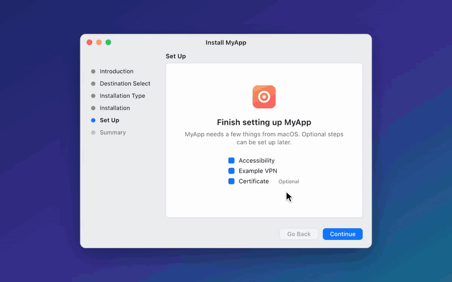

# Installer panes

`PermissionInstaller` adds a Set Up section to your `.pkg`, after Install. It shows one
pane per step, and each step is either required (Continue stays disabled until it's
done) or optional (the user can skip it). Panes skip ahead when a step is already done,
and the last pane lists anything skipped and opens your app.

Steps can be any System Settings permission in the [guide](guide.md#supported-permissions), a VPN or proxy configuration, a
trusted root certificate, or your own step.



## 1. Define the setup

Put this in a target that both your app and your installer plugin depend on:

```swift
import PermissionInstaller

extension InstallerSetup {
    static let myApp = InstallerSetup(
        appName: "MyApp",
        steps: [
            .permission(.fullDiskAccess),
            .permission(.systemExtension(vpn)),
            .networkConfiguration(.init(.packetTunnel, providerBundleIdentifier: "com.example.myapp.tunnel")),
            .certificate(.init(resourceName: "RootCA"), .optional),
            .permission(.screenRecording, .optional),
            .custom(
                id: "login-item",
                title: "Open at Login",
                heading: "Open MyApp at login",
                message: "MyApp runs in the background so it's always protecting you.",
                actionTitle: "Open at Login",
                .optional,
                check: { SMAppService.mainApp.status == .enabled },
                perform: { try SMAppService.mainApp.register() }
            ),
        ],
        tint: .systemIndigo
    )
}
```

Steps are required unless you pass `.optional`. Each step's `heading`, `message` and
`actionTitle` have defaults. Pass your own to any step:

```swift
.permission(.fullDiskAccess, message: "MyApp scans your whole disk for duplicates.")
```

## 2. Handle the installer in your app

The installer does each step by launching your installed app in the background, so
permissions, system extensions and network configurations belong to your app, not to
Installer. Call this before any UI:

```swift
@main
struct MyApp: App {
    init() {
        InstallerSetup.myApp.handleInstallerLaunch()
    }
    // ...
}
```

It returns right away on a normal launch. When the installer launched the app, it checks
or performs the step (showing PermissionGuide's guide, without a Dock icon) and exits.

## 3. Build the plugin

Make a dynamic library target that depends on `PermissionInstallerPlugin`:

```swift
import Foundation
import PermissionInstaller
import PermissionInstallerPlugin

@objc(MyAppInstallerPlugin)
final class MyAppInstallerPlugin: InstallerPlugin {
    override var setup: InstallerSetup { .myApp }
}
```

Wrap it in a bundle (`SetupPane.bundle/Contents/MacOS/<executable>`) whose Info.plist has:

| Key | Value |
| --- | --- |
| `NSPrincipalClass` | `PermissionInstallerSection` |
| `PermissionInstallerProvider` | Your subclass's `@objc` name |
| `InstallerSectionTitle` | Sidebar title, such as `Set Up` |

Then list the bundle after `Install` in `InstallerSections.plist` and pass the folder to
`productbuild --plugins`. The `build-pkg` recipe in the [`justfile`](../justfile)
does all of this.

Installer warns that the package "will run a program to determine if the software can be
installed" whenever it has a plugin. Sign the plugin, app and package with your
Developer ID for release.

## Try the demo

`just demo-pkg` builds and opens `Examples/InstallerDemo`. It has a required Full Disk Access
step, a required custom step, and optional steps for every other kind. Its VPN, Endpoint
Security and VPN configuration steps fail on purpose: the demo has no real extension or
Network Extension entitlement. Remove the installed app with `just uninstall-pkg`.
